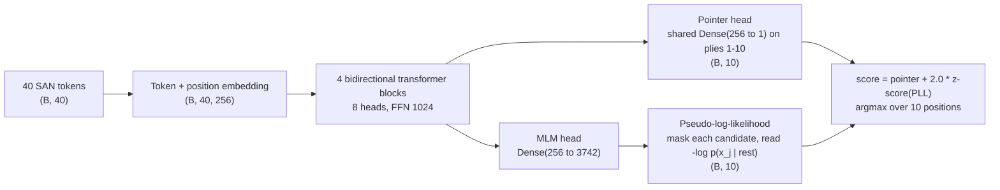

# Chess Move Error Detection with a Bidirectional Transformer

[](https://colab.research.google.com/github/gabrielmario-tavini/chess-move-error-detection/blob/main/chess_error_detection.ipynb)


A transformer that finds the single corrupted move in a chess game **without knowing
the rules of chess**: moves are opaque tokens and everything is learned from data.

**96.9% top-1 accuracy** on 50,000 unseen games, with **5.09M parameters** under a 6M
budget. The best non-neural baseline reaches 42.6%.

Final project of the Deep Learning course, M.Sc. in Automation Engineering, University
of Bologna, graded 30/30.

## The problem

Each example is the first 40 plies of a real game in SAN notation. Exactly one of the
first 10 plies has been replaced by the move played at the same ply in a *different*
real game. The model must say which one.

```text
original : e4 e5 Nf3 Nc6 Bb5 a6 Ba4 Nf6 O-O Be7 ...
corrupted: e4 e5 Nf3 e6  Bb5 a6 Ba4 Nf6 O-O Be7 ...   ->  position 4
```

Constraints: no chess knowledge (no legality checks, engines, opening books or
hand-built features), no externally pre-trained models, the replaced move usable only
as a training label, at most 6,000,000 trainable parameters.

The substitute move is drawn from the same ply of another game, so it is perfectly
plausible *in isolation*. It can only be detected as inconsistent with its context,
which makes this a **sequence anomaly-detection problem** rather than a chess problem.

## Approach



1. **Signal analysis before any model.** Count-based baselines showed that a
   backward-looking method scores **exactly 0% on positions 1 and 2**: early openings are
   so common that a wrong first move still looks plausible. Those positions can only be
   solved from the *future* plies 11-40, which rules out a causal model and makes a
   **bidirectional** encoder mandatory.
2. **Pointer head with a shared scorer.** One `Dense(256 to 1)` applied to each candidate
   position instead of a `Flatten + Dense(10)`: 257 parameters instead of 102,400, and
   the same "is this move inconsistent with its context?" function for all ten slots,
   the same argument as weight sharing in convolutions.
3. **Self-supervised pre-training (masked language modelling).** The labels carry only
   ~3.3 bits per game, and more regularization did not close the train/val gap.
   Predicting randomly masked moves gives ~16M training targets from the same data and
   teaches the model exactly the notion it needs. After pre-training it guesses the
   exact masked move 68% of the time out of 3,742.
4. **Multi-task fine-tuning** keeps the masked-move objective active (weight 0.3), so
   one encoder serves both heads.
5. **Two-score inference.** The masked-move head gives a second, structurally different
   score for each candidate. The two scores are almost equally strong alone but make
   different mistakes, so combining them is an ensemble at almost zero parameter cost.

## Results

| Model | Validation | Test |
|---|---|---|
| Random | - | 0.100 |
| Best count-based baseline (first prefix break) | - | 0.426 |
| Transformer from scratch | 0.929 | 0.931 |
| + masked-move pre-training | 0.960 | - |
| + multi-task fine-tuning (pointer only) | 0.959 | 0.960 |
| Masked-move score alone | 0.956 | - |
| **Pointer + masked-move score** | **0.968** | **0.969** |

Accuracy by corrupted position, final model vs. count-based baseline (test set):

| Position | 1 | 2 | 3 | 4 | 5 | 6 | 7 | 8 | 9 | 10 |
|---|---|---|---|---|---|---|---|---|---|---|
| Transformer | **0.983** | **0.974** | 0.957 | 0.964 | 0.959 | 0.965 | 0.963 | 0.970 | 0.976 | 0.978 |
| Baseline | 0.000 | 0.002 | 0.303 | 0.400 | 0.553 | 0.680 | 0.701 | 0.645 | 0.546 | 0.421 |

The positions where the baseline is blind are the ones the transformer solves best.

## What did not work, and why

Run-to-run variance was **measured** (0.14 points, consistent with the 0.15 standard error
of a 20,000-game validation set) and used as a noise floor: any change below it was
treated as inconclusive.

- **Stronger regularization** (dropout 0.2, label smoothing, longer training): train/val
  gap unchanged at 5.5 points. The limit was supervision, not regularization, which is
  what motivated pre-training.
- **Weight averaging (SWA)**: no gain, because the snapshots came from the end of a cosine
  schedule and were essentially the same point.
- **Longer fine-tuning** (24 epochs): worse, because a longer cosine schedule dilutes the
  final annealing. Epochs and final learning rate must be changed together.
- **Pre-training beyond 12-16 epochs**: saturates.
- **Heavier multi-task weight (1.0)**: improves the masked-move score exactly as predicted
  but costs the pointer the same amount, a zero-sum trade-off.
- **Post-hoc calibration** (per-position weights, temperature): below the noise floor.
  The limit is in the two scores, not in how they are combined.

## Run it

Click **Open in Colab** above, select a T4 GPU, and run the cells listed below. The
dataset is in [`data/`](data/) and is fetched automatically when the notebook is opened
on its own.

| Path | Cells | Time on a T4 |
|---|---|---|
| Reproduce the result from trained weights | Data, Steps 0, 1.1, 1.2, 2, 2.1, 3, 3.1, 10 | ~5 min |
| Full training | Data, Steps 0, 1, 2, 3, 6, 7c, 8b | ~2.5 h |

Expected output of the fast path: `PARAMETERS: 5089705` and `ACCURACY@1: 0.96894`.

Locally:

```bash
git clone https://github.com/gabrielmario-tavini/chess-move-error-detection.git
cd chess-move-error-detection
pip install -r requirements.txt
jupyter notebook chess_error_detection.ipynb
```

## Repository structure

```text
chess_error_detection.ipynb   full pipeline: analysis, baselines, model, experiments, results
data/                         train (400,000 games) and test (50,000 games), gzip CSV
requirements.txt
LICENSE
```

The trained weights (`joint.weights.h5`, 61.3 MB) are attached to the
[v1.0 release](https://github.com/gabrielmario-tavini/chess-move-error-detection/releases/tag/v1.0)
and are downloaded automatically by Step 10.

## Acknowledgements

Dataset and task specification by the Deep Learning course at the University of
Bologna. `TransformerBlock` and `TokenAndPositionEmbedding` are adapted from the course
lab notebooks, with a fix to the attention `key_dim`, which in Keras is the per-head
dimension.

## Author

**Gabrielmario Tavini**, M.Sc. Automation Engineering, University of Bologna.
[LinkedIn](https://www.linkedin.com/in/gabrielmario-tavini/) · [GitHub](https://github.com/gabrielmario-tavini)
